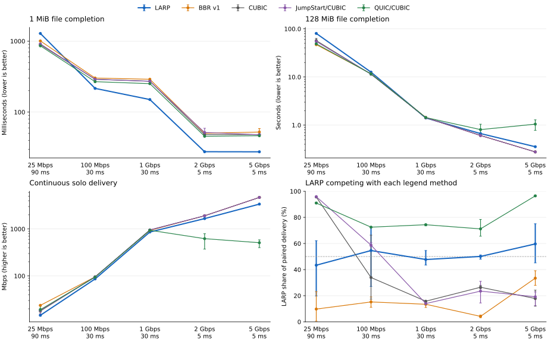

# TCP LARP

Linux TCP congestion control with speculative pacing and adaptive flight limits.
Queue probes require measured delivery gain, rate growth requires current RTT,
and the minimum RTT is periodically revalidated. Initial defaults: 1 Gbps pacing,
512-segment flight limit; qualified feedback can raise both.

Build against Linux kernel headers (tested on 6.12):

```sh
make
```



Three runs per condition in a two-vCPU Linux VM. Points are means; whiskers are
observed ranges. Solo delivery uses a 6-second window after 2 seconds of warmup;
pairs use 10 seconds. File completion includes connection setup. The 25 Mbps
path uses a shallow RED/ECN queue; other paths use FIFO queues sized to one BDP.
The first three panels use logarithmic vertical axes. For LARP/self pairs,
the fourth panel shows the first sender's share; 50% means equal delivery.

LARP improves small-file startup on four tested paths, but has lower continuous
solo delivery than CUBIC/BBR and uneven sharing. JumpStart/CUBIC is an experimental
port. QUIC uses quic-go v0.54.0 with its built-in CUBIC selected, TLS 1.3 and no
0-RTT; TCP is unencrypted. These are transport/implementation comparisons on a
virtual testbed. Research prototype; GPL-2.0-only.
